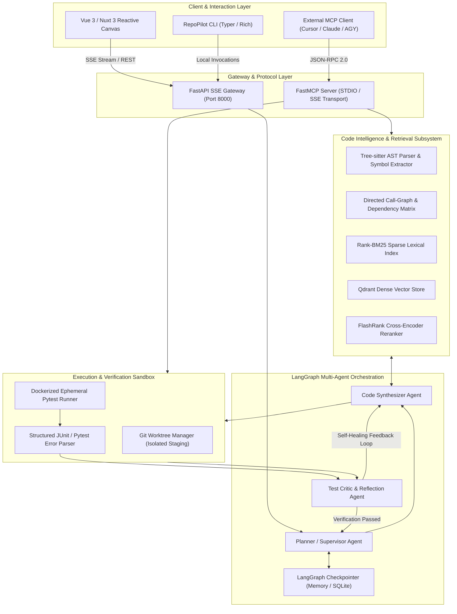
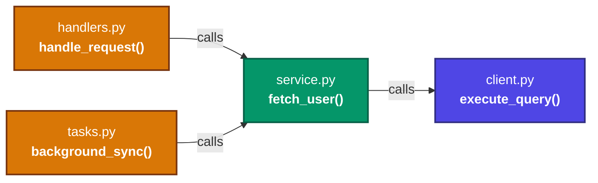
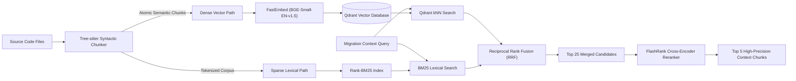
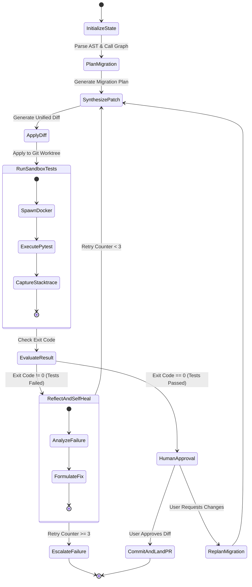

# System Architecture Document

## RepoPilot: Autonomous Codebase Modernization & Migration Agent

**Author:** Anmol Vishvas (<anmol23vishvas@gmail.com>)  
**Target Repository:** [https://github.com/anmolvishvas/RepoPilot](https://github.com/anmolvishvas/RepoPilot)  
**Document Version:** 1.0.0  
**Status:** Architecture Baseline  

---

## 1. System Overview & Architectural Paradigm

RepoPilot is architected around a closed-loop cybernetic control pattern: **Perceive $\rightarrow$ Reason $\rightarrow$ Act $\rightarrow$ Verify $\rightarrow$ Reflect**. Unlike conversational code assistants that produce unverifiable text fragments, RepoPilot operates as an autonomous, deterministic refactoring engine that treats code as a structured abstract syntax tree (AST), leverages hybrid information retrieval over code graphs, and subjects all modifications to isolated sandbox verification before human review.



---

## 2. Core Subsystems Breakdown

### 2.1 Subsystem 1: Code Intelligence & AST Subsystem

The Code Intelligence subsystem transforms raw, unstructured source code into an unambiguous, queried symbol dependency graph.

#### 2.1.1 Tree-sitter AST Extraction
- **Grammar Support:** Leverages language-specific Tree-sitter grammars (e.g., `tree-sitter-python`, `tree-sitter-typescript`).
- **Semantic Node Mapping:** Rather than treating code as text lines, Tree-sitter walks the concrete syntax tree (CST) and extracts high-level semantic units:
  - Function and method declarations with parameter signatures, return type annotations, docstrings, and start/end byte offsets.
  - Class definitions, class hierarchies, decorators, and member symbols.
  - Import declarations (`import x`, `from y import z as w`), aliases, and module paths.
  - Call expressions (`module.service.call_method()`), identifying invocations across boundaries.

#### 2.1.2 Symbol Table & Directed Call-Graph Resolution
- **Symbol Table:** An in-memory indexed catalog linking qualified symbol identifiers (e.g., `repopilot.core.parser.TreeSitterParser.parse_file`) to their file paths, AST node types, and line spans.
- **Call-Graph Construction:** Scans all call sites and resolves target references against imports and local scopes. Builds a directed graph $G = (V, E)$, where $V$ represents callable symbols and $E$ represents caller-to-callee dependencies.
- **Blast-Radius Computation:** When a symbol signature or behavior changes, RepoPilot traverses reverse edges ($u \leftarrow v$) to compute the exact downstream impact radius, providing the Planner Agent with an exhaustive list of files requiring synchronized modifications.



---

### 2.2 Subsystem 2: Hybrid Code-RAG Pipeline

Naive text chunking (e.g., 500-token sliding windows with 50-token overlap) causes catastrophic failures in code refactoring by severing function headers from their bodies or discarding class context. RepoPilot employs an AST-guided hybrid retrieval pipeline.



#### 2.2.1 Syntactic AST-Bound Chunking
- Chunks correspond strictly to complete semantic AST nodes (individual functions, classes, or module-level blocks).
- Metadata enrichment: Every chunk is tagged with its fully-qualified symbol name, file path, parent class, docstring, parameter list, and import declarations.
- Large function handling: Functions exceeding 1,200 tokens are split at logical AST statement block boundaries with parent signature headers prepended to each sub-chunk to preserve context.

#### 2.2.2 Dual Retrieval & Reciprocal Rank Fusion (RRF)
1. **Dense Retrieval:** FastEmbed (`BAAI/bge-small-en-v1.5` or `text-embedding-3-small`) indexes the semantic intent of docstrings, type annotations, and method behaviors into Qdrant.
2. **Sparse Retrieval:** `rank-bm25` indexes exact variable names, function identifiers, error strings, and parameter tokens to guarantee exact-match lexical discovery.
3. **Reciprocal Rank Fusion (RRF):** Merges the two ranked lists deterministically:
   $$RRF\_Score(d \in D) = \sum_{m \in \{dense, sparse\}} \frac{1}{k + r_m(d)}$$
   where $k = 60$ and $r_m(d)$ is the 1-based rank in method $m$.

#### 2.2.3 Cross-Encoder Reranking (FlashRank)
The top 25 candidates from RRF pass through a lightweight, ultra-fast cross-encoder model (`ms-marco-TinyBERT-L-2-v2` or `ms-marco-MiniLM-L-12-v2` via `flashrank`). FlashRank computes deep query-document attention with zero PyTorch dependency in $<120$ms on CPU, eliminating false positives before passing context to the LLM.

---

### 2.3 Subsystem 3: FastMCP Code Server Layer

RepoPilot implements the open **Model Context Protocol (MCP)** specification via the official `fastmcp` SDK. This architecture decouples the code-intelligence tools from any specific AI model or proprietary IDE harness.

#### 2.3.1 Exposed Tool Interface
The FastMCP server exposes four strictly validated, sandboxed tools:

1. `search_ast_symbols(query: str, symbol_type: Optional[str], max_results: int = 10) -> List[SymbolInfo]`
   - Searches the AST symbol catalog and directed graph for declarations, call sites, and inheritance trees.
2. `read_file_range(file_path: str, start_line: int, end_line: int) -> FileContentSnippet`
   - Safely reads exact line ranges without flooding LLM context with full file contents. Prevents directory traversal attacks via path canonicalization.
3. `apply_unified_diff(patch_str: str, target_file: str) -> PatchResult`
   - Validates and applies a unified diff against an isolated git worktree. Verifies post-patch syntax with Tree-sitter prior to committing.
4. `run_isolated_tests(test_path: Optional[str], timeout_seconds: int = 60) -> SandboxExecutionResult`
   - Spawns an isolated Docker container, executes the target test suite, and returns structured stdout, stderr, exit code, and failed test assertions.

---

### 2.4 Subsystem 4: LangGraph Multi-Agent Orchestration

The core modernization workflow is modeled as a cyclic state graph in **LangGraph**, providing checkpointed, immutable state transitions and deterministic error recovery.



#### 2.4.1 Agent Roles & State Schema
- **Supervisor / Planner Agent:** Evaluates the overall migration task (e.g., "migrate all `httpx.get` calls to `await client.get`"), identifies affected files via the call graph, and generates an ordered multi-stage execution plan.
- **Code Synthesizer Agent:** Generates unified diffs for target files, adhering strictly to syntactic conventions, type signatures, and import structures.
- **Sandboxed Test Critic Agent:** Ingests Pytest failures and tracebacks, isolates the root cause (e.g., missed `await`, incorrect parameter type, missing fixture), and formulates targeted repair guidance for the Synthesizer.
- **Checkpointing & Time-Travel:** LangGraph state is persisted to an SQLite or PostgreSQL checkpointer, allowing users to pause runs, inspect state history, and rollback to prior steps effortlessly.

---

## 3. Technology Stack & Technical Rationale

| Layer | Technology | Technical Rationale & Alternatives Considered |
| :--- | :--- | :--- |
| **Language & Runtime** | **Python 3.11+** | Modern structural pattern matching, `asyncio.TaskGroup`, exception groups (`ExceptionGroup`), and strict performance enhancements. |
| **Agent State Machine** | **LangGraph** | Enables cyclic loops, state persistence, branch merging, and deterministic human-in-the-loop checkpoints. *Alternative rejected: CrewAI/AutoGen (too opaque, lack deterministic state machine and fine-grained cycle control).* |
| **Tool Protocol** | **FastMCP (Python)** | Industry standard for exposing tools to LLMs; enables universal interoperability with Cursor, Claude Desktop, and Antigravity. *Alternative rejected: Proprietary OpenAI Function Calling schema (locks tools into single vendor).* |
| **AST Parsing Engine** | **Tree-sitter** | High-performance, incremental C-based AST parser with multi-language grammar support and native byte-offset extraction. *Alternative rejected: Python `ast` module (limited to Python only, loses exact formatting/whitespace).* |
| **Dense Vector Store** | **Qdrant** | High-performance, low-latency Rust-based vector search engine with native payload filtering and local embedded or containerized operation. |
| **Sparse Lexical Search**| **Rank-BM25** | Industry-standard Okapi BM25 implementation; essential for code search where exact keyword matches (method names, error strings) outperform embeddings. |
| **Reranker** | **FlashRank** | Zero-dependency, lightweight cross-encoder inference running in $<150$ms on CPU. *Alternative rejected: Cohere API (adds external network dependency and latency).* |
| **Sandbox Execution** | **Docker SDK for Python**| True OS-level virtualization with kernel namespace isolation, resource limits (cgroups), and network disabling. *Alternative rejected: Virtual environments on host (untrusted code execution risk).* |
| **API & Streaming Gateway**| **FastAPI + SSE** | High-throughput asynchronous HTTP framework supporting native Server-Sent Events (SSE) for streaming agent reasoning traces and tool outputs. |
| **Frontend Dashboard** | **Vue 3 / Nuxt 3** | Lightweight, reactive component system with optimal bundle sizes and seamless streaming state management. |
| **Observability** | **Langfuse** | Open-source LLM observability platform tracking prompt versions, token consumption, latency, and step-by-step agent traces. |

---

## 4. Complete Project Directory Structure

```
RepoPilot/
├── .github/
│   ├── PULL_REQUEST_TEMPLATE.md
│   └── workflows/
│       ├── ci.yml
│       └── pr-audit.yml
├── docs/
│   ├── PRD.md
│   ├── ARCHITECTURE.md
│   ├── RULES.md
│   ├── DESIGN.md
│   ├── TASKS.md
│   └── MEMORY.md
├── src/
│   └── repopilot/
│       ├── __init__.py
│       ├── py.typed
│       ├── config.py                 # Pydantic v2 application settings
│       ├── ast/                      # Subsystem 1: AST & Call Graph
│       │   ├── __init__.py
│       │   ├── parser.py             # Tree-sitter AST parsing engine
│       │   ├── symbol_table.py       # Symbol definition and lookup table
│       │   ├── call_graph.py         # Directed graph builder & blast-radius calculator
│       │   └── models.py             # AST Node & Edge domain schemas
│       ├── rag/                      # Subsystem 2: Hybrid Code-RAG
│       │   ├── __init__.py
│       │   ├── chunker.py            # Syntactic AST node chunker
│       │   ├── embeddings.py         # Dense embeddings wrapper (FastEmbed)
│       │   ├── vector_store.py       # Qdrant client & index manager
│       │   ├── bm25_index.py         # Rank-BM25 sparse indexer
│       │   ├── fusion.py             # Reciprocal Rank Fusion (RRF) logic
│       │   └── reranker.py           # FlashRank cross-encoder reranker
│       ├── mcp/                      # Subsystem 3: FastMCP Code Server
│       │   ├── __init__.py
│       │   ├── server.py             # FastMCP server definition & tool registry
│       │   ├── tools_ast.py          # AST symbol search MCP tools
│       │   ├── tools_file.py         # Line-range reader & unified diff applier
│       │   └── tools_sandbox.py      # Dockerized test execution tools
│       ├── sandbox/                  # Verification Sandbox
│       │   ├── __init__.py
│       │   ├── runner.py             # Docker container manager & timeout guards
│       │   ├── worktree.py           # Isolated git worktree staging manager
│       │   └── pytest_parser.py      # JUnit XML & Pytest stdout parser
│       ├── agents/                   # Subsystem 4: LangGraph Multi-Agent Engine
│       │   ├── __init__.py
│       │   ├── state.py              # Immutable LangGraph state schemas
│       │   ├── graph.py              # StateGraph definition & edge transitions
│       │   ├── planner.py            # Supervisor / Planner agent node
│       │   ├── synthesizer.py        # Code Synthesizer agent node
│       │   ├── critic.py             # Test Critic & Reflection agent node
│       │   └── checkpointer.py       # State persistence & time-travel manager
│       └── server/                   # Gateway & Streaming API
│           ├── __init__.py
│           ├── app.py                # FastAPI gateway application
│           ├── routes_stream.py      # Server-Sent Events (SSE) streaming endpoints
│           └── routes_migration.py   # Migration task initiation & approval endpoints
├── tests/
│   ├── conftest.py                   # Pytest fixtures and test container mocks
│   ├── unit/
│   │   ├── test_ast_parser.py
│   │   ├── test_call_graph.py
│   │   ├── test_chunker.py
│   │   ├── test_hybrid_rag.py
│   │   └── test_diff_engine.py
│   ├── integration/
│   │   ├── test_mcp_server.py
│   │   ├── test_docker_sandbox.py
│   │   └── test_langgraph_workflow.py
│   └── e2e/
│       └── test_sync_to_async_migration.py
├── ui/                               # Frontend Reactive Canvas
│   ├── package.json
│   ├── nuxt.config.ts
│   ├── app.vue
│   ├── components/
│   │   ├── ExecutionTrace.vue        # Real-time SSE streaming trace
│   │   ├── UnifiedDiffViewer.vue     # Split-screen syntax-highlighted diff
│   │   └── DependencyMiniMap.vue     # Interactive call-graph blast radius
│   └── composables/
│       └── useMigrationStream.ts     # SSE connection and reactive state
├── Dockerfile.sandbox                # Disposable test runner image definition
├── pyproject.toml                    # Poetry/Hatch build configuration & dependencies
├── ruff.toml                         # Ruff linting and formatting configuration
├── mypy.ini                          # Strict Mypy type-checking rules
└── README.md                         # Public presentation and quickstart guide
```
